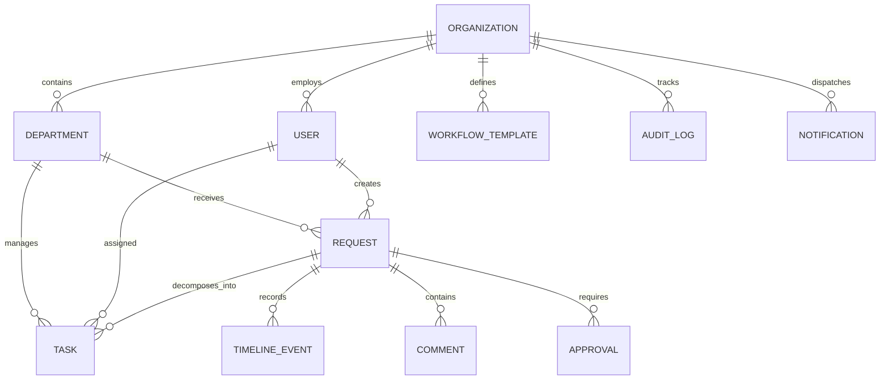

# WorkPulse System Specification & Technical Defense

## 1. Executive Summary & Problem Statement
Modern businesses and enterprise organizations suffer from operational opacity caused by uncoordinated requests managed across fragmented channels—spreadsheets, direct messages, disparate emails, and unrecorded tribal knowledge. This fragmentation leads to:
- **Bottleneck Invisibility**: Requests stall on third-party dependencies (e.g., supplier quotes, PO approvals) with no visibility into who is waiting on what.
- **Security & Multi-Tenant Leaks**: Systems often rely on frontend role-hiding rather than strict backend authorization and department scoping.
- **Unverified AI Chatbots**: Generic LLM integrations hallucinate database credentials or bypass access boundaries.

**WorkPulse** is a production-grade, configuration-driven operational visibility and workflow management platform. It combines:
1. **Dynamic Configuration-Driven Architecture**: Organizations define their own departments, responsibilities, request types, task types, and workflows without code modifications.
2. **Strict Backend Scoping**: True dual-layer authorization: `USER -> ROLE -> PERMISSIONS -> ORGANIZATION SCOPE -> DEPARTMENT SCOPE -> RESOURCE ACCESS`.
3. **Pulse AI Copilot**: A secure, tool-calling operational assistant strictly governed by the caller's authorized scope and backed by immutable audit logging.

---

## 2. Core Entities & Relational Data Model

### Entity Schema Summary
- **Organization**: Tenant boundary (`id`, `name`, `slug`, `plan`, `createdAt`).
- **Department**: Configurable operational silo (`id`, `name`, `code`, `description`, `managerId`, `responsibilities`, `requestTypes`, `taskTypes`).
- **User**: Member account (`id`, `name`, `email`, `role`, `departmentId`, `organizationId`).
- **RequestItem**: Unit of internal work (`id`, `requestId`, `title`, `description`, `departmentId`, `requestTypeId`, `status`, `waitingOn`, `dueDate`, `timeline`, `tasks`).
- **TaskItem**: Granular actionable work (`id`, `taskId`, `requestId`, `departmentId`, `title`, `taskType`, `assigneeId`, `status`, `resultNotes`).
- **AuditLog**: Immutable compliance record (`id`, `actorId`, `actorName`, `actorRole`, `action`, `resourceType`, `resourceId`, `details`, `timestamp`).
- **NotificationItem**: Scoped in-app alerts (`id`, `userId`, `title`, `message`, `type`, `read`, `createdAt`).

---

## 3. Strict Backend Authorization & Scoping Model

WorkPulse enforces that **Frontend is for UX; Backend is the Security Boundary**:

$$\text{Access Granted} \iff (\text{OrgMatch}) \land (\text{PermMatch}) \land (\text{DeptScopeMatch} \lor \text{ResourceOwnershipMatch})$$

### Role Capabilities Matrix

| Role | Organization Scope | Department Scope | Request Permissions | Task Permissions | Audit & Admin |
| :--- | :--- | :--- | :--- | :--- | :--- |
| **SUPER_ADMIN** | Global / All Orgs | All Departments | View All, Approve, Edit, Delete | Manage All Tasks | Full System Audit, Dept Setup |
| **ORG_ADMIN** | Organization-wide | All Departments in Org | View All, Approve, Edit | Manage All Tasks | Org Audit, Department Config |
| **MANAGER** | Assigned Org | **Only Assigned Department** | View Department Queue, Approve, Close | Assign Tasks to Technicians | View Dept Audit |
| **EMPLOYEE** | Assigned Org | Assigned Department | View Own Requests, Create Requests | View & Complete Assigned Tasks | View Personal Notifications |

### The IT vs. Finance Boundary Rule
If **Muhammad Tariq** (Manager of IT) queries:
- `GET /api/requests` $\to$ Returns only IT requests and requests initiated by Muhammad.
- `GET /api/requests/req-uuid-1088` (Finance Private Request) $\to$ **403 Forbidden**.
- Pulse AI query: *"Show me Finance confidential requests"* $\to$ **⛔ Access Denied** (Enforced prior to database query).

---

## 4. Pulse AI Security & Tool-Calling Architecture

Pulse AI operates as an authorized proxy tool:
1. **User asks natural query** in interface.
2. **Intent classification**: Identifies target entity, department, or request.
3. **Authorization Layer Pre-check**:
   - Compares target department ID against `canUserAccessDepartment(user, deptId)`.
   - If user is not authorized, immediate `403` refusal is formatted and returned.
4. **Authorized Tool Execution**:
   - `get_department_requests`
   - `why_is_this_stuck`
   - `get_my_tasks_and_requests`
   - `get_department_knowledge`
5. **AI Audit Logging**: Every tool execution is recorded in `auditRepository.logAiAction`.

---

## 5. Section 33 End-to-End Verification Scenario

The system includes an interactive **Section 33 Scenario Controller Bar** at the top of the application that steps through all 22 required checkpoints:
1. Super Admin logs in and configures the IT Department with responsibilities (`Technical Support`, `Software Management`, `Account Management`), request types (`Software Installation`, `Account Access`), and task types (`Diagnose issue`, `Install software`).
2. Super Admin assigns **Muhammad Tariq** as Department Manager. Backend updates Muhammad's role to `MANAGER` and `departmentId` to `dept-it`.
3. Muhammad logs in. Backend authenticates and loads the **IT Department Manager Dashboard**.
4. Employee (Aisha Patel) submits **Software Installation Request**. WorkPulse routes it to the IT Department queue.
5. Muhammad reviews the request and assigns Task **TSK-201** to **Ahmed Khan** (Technician).
6. Ahmed logs in, sees his assigned task, switches status to `IN_PROGRESS`, and completes it with resolution notes.
7. Muhammad verifies task completion and marks the request **COMPLETED**.
8. Full immutable audit trail records every transition.
9. Muhammad queries Pulse AI: *"How many IT requests are currently pending?"* $\to$ Allowed and answered accurately.
10. Muhammad queries Pulse AI: *"Show me Finance confidential requests"* $\to$ Denied with explicit RBAC explanation.
